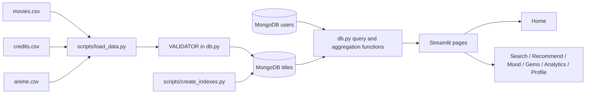

# Unified Movie + Anime Recommendation Engine

## Project pitch

This college project is a unified discovery platform for movies and anime,
powered by MongoDB rather than machine-learning libraries. It cleans and
combines three source CSV files into one validated `titles` collection,
then uses MongoDB queries and aggregation pipelines to deliver search,
cross-media similarity, mood discovery, hidden-gem detection, analytics, and
user-personalized recommendations through a Streamlit interface.

## What makes it novel

- **Unified movie + anime schema:** one `titles` collection supports both
  media types while preserving type-specific embedded fields.
- **Aggregation-only recommendation engine:** recommendations use MongoDB
  stages such as `$lookup`, `$setIntersection`, `$setWindowFields`, `$facet`,
  `$bucket`, and `$percentile`; no scikit-learn or other ML library is used.
- **Cross-media recommendations:** a movie can lead to anime suggestions and
  an anime can lead to movie suggestions.
- **Mood search:** genre-derived tags such as `feel-good`, `epic`, and
  `mind-bending` provide an explainable discovery route.
- **Hidden gems:** high-rated titles below a MongoDB-computed vote percentile
  surface less popular discoveries.
- **Personalization:** embedded user ratings and watchlists drive weighted
  genre profiles and explanations such as “because you liked ...”.

## Architecture



All database access is centralized in [db.py](db.py). Streamlit pages call
backend functions and contain no MongoDB queries of their own.

## Technology stack

| Area | Technology |
| --- | --- |
| Database | MongoDB 8.2.3 |
| Python driver | PyMongo 4.19 |
| Frontend | Streamlit 1.66 |
| Data cleaning | pandas 3.0 |
| Charts | Plotly 7 |
| Configuration | python-dotenv |
| Runtime | Python 3.13, Windows 11 |
| Recommendation logic | MongoDB queries and aggregation pipelines only |

## Windows setup

Open PowerShell in the project folder.

### 1. Create and activate a virtual environment

```powershell
py -3.13 -m venv venv
.\venv\Scripts\Activate.ps1
```

If PowerShell blocks activation, either run the project with the interpreter
directly (`.\venv\Scripts\python.exe`) or adjust the execution policy for your
user account.

### 2. Install dependencies

```powershell
python -m pip install --upgrade pip
pip install -r requirements.txt
```

### 3. Configure MongoDB

Ensure local MongoDB is running at `mongodb://localhost:27017`. Create a
`.env` file in the project root:

```dotenv
MONGO_URI=mongodb://localhost:27017
DB_NAME=media_recommender
```

Do not commit `.env` or credentials.

### 4. Load and index the data

```powershell
python .\scripts\load_data.py
python .\scripts\create_indexes.py
python .\scripts\seed_users.py
```

`load_data.py` intentionally drops and recreates `titles`, so it is
re-runnable. The current cleaned dataset loads approximately 4,392 movies and
13,260 anime titles; Hentai anime and movies with fewer than 10 votes are
excluded by default.

### 5. Run the application

```powershell
streamlit run .\app.py
```

Open the local URL printed by Streamlit, normally
`http://localhost:8501`.

### 6. Optional verification and benchmark

```powershell
python .\scripts\test_backend.py
python .\scripts\benchmark.py
```

The benchmark writes [docs/benchmark.csv](docs/benchmark.csv) and
[docs/benchmark.html](docs/benchmark.html).

## Schema

### `titles`

Movies and anime share these top-level fields:

`media_type`, `source_id`, `title`, `alt_titles`, `genres`, `synopsis`, `year`,
`rating`, `votes`, `popularity`, `language`, `poster_url`, `status`, and
`mood_tags`.

Movie-specific fields are embedded under `movie`:

`runtime`, `budget`, `revenue`, `tagline`, `director`, top-five `cast`,
`keywords`, `companies`, and `countries`.

Anime-specific fields are embedded under `anime`:

`type`, `episodes`, `studios`, `producers`, `source`, `premiered`,
`duration_minutes`, `age_rating`, `rank`, `members`, `favorites`, and `airing`.

`VALIDATOR` in [db.py](db.py) requires `media_type`, `title`, and `rating`, and
restricts ratings to the 0-10 range.

### `users`

Each user stores `username`, `created_at`, a `watchlist` of title IDs, embedded
`ratings` containing `title_id`, `rating`, and `rated_at`, and
`favorite_genres`. The profile pipeline computes taste information from the
ratings and joined title documents.

### Embedding versus referencing

- **Embedded movie/anime details:** type-specific fields are embedded because
  they belong to exactly one title and are read together on title cards.
  This avoids an extra lookup for normal browsing and keeps the unified
  document easy to explain.
- **Embedded user ratings:** ratings are embedded because a user normally
  reads and updates their own rating list together. The list is small for the
  intended college-project workload.
- **Title IDs in user watchlists/ratings:** users store stable string IDs such
  as `movie:19995` rather than copying title documents. The personalization
  pipeline uses `$lookup` to obtain current title metadata, avoiding stale
  duplicated content.
- **Separate `users` collection:** users change independently of catalog
  reloads, so separating them prevents title imports from rewriting user data.

See the detailed field mappings and examples in
[docs/schema.md](docs/schema.md).

## Indexes

The indexes are created by [scripts/create_indexes.py](scripts/create_indexes.py).

| Index | Fields | Query served |
| --- | --- | --- |
| `uq_media_type_source_id` | `media_type ASC, source_id ASC` | Prevents duplicate source records and supports title lookup. |
| `text_title_alt_titles_synopsis` | Weighted text on `title`, `alt_titles`, `synopsis` | Full-text catalog search; title has the highest weight. |
| `genres_multikey` | `genres ASC` | Genre filters and genre aggregation access. |
| `media_rating_votes_desc` | `media_type ASC, rating DESC, votes DESC` | Top-rated browsing within movies or anime. |
| `mood_tags_multikey` | `mood_tags ASC` | Mood recommendation filters. |
| `year` | `year ASC` | Year filters and year-based reports. |
| `uq_username` on `users` | `username ASC` | Unique user creation and username lookup. |

## Key aggregation pipelines

- **`similar_titles`:** Looks up the source title, compares candidate genre
  and feature sets with `$setIntersection`/`$setUnion`, then combines overlap
  and rating distance into a similarity score.
- **`mood_recommendations`:** Filters mood tags and computes a Bayesian
  weighted rating using each title's votes, rating, and a catalog prior.
- **`hidden_gems`:** Uses `$percentile` to find a low-vote threshold, then
  returns titles above the requested rating and below that threshold.
- **`top_by_genre_per_year`:** Unwinds genres and uses `$setWindowFields` with
  `$rank` to identify the best titles for every genre/year partition.
- **`taste_profile`:** Joins user ratings to titles and uses `$facet` to
  calculate weighted genres, average user rating, and media preference split.
- **`personalized_recommendations`:** Excludes rated/watchlisted IDs, compares
  candidate genres with rated titles, computes Bayesian quality, and generates
  a “because you liked ...” explanation.
- **`genre_counts`:** Unwinds genres and groups them into a catalog frequency
  report.
- **`avg_rating_by_year`:** Groups titles by year for average rating trends.
- **`rating_distribution`:** Uses `$bucket` to create rating histogram bands.
- **`top_studios` / `top_directors`:** Unwinds or groups type-specific fields
  to rank the most represented anime studios and movie directors.
- **`media_type_comparison`:** Uses `$facet` to compare title counts, average
  ratings, average votes, and rating buckets for movies versus anime.
- **`home_stats`:** Uses a `$facet` to calculate total titles, media totals,
  and distinct genre count for the home-page metric cards.

## Benchmark results

The benchmark compares 20 executions with normal query planning against 20
executions forced to use a collection scan. Results were generated against
17,652 loaded titles.

| Query | Collection scan avg | Indexed avg | Scan docs examined | Indexed docs examined |
| --- | ---: | ---: | ---: | ---: |
| Text search | 64.288 ms | 0.588 ms | 17,652 | 5 |
| Genre filter | 51.552 ms | 45.350 ms | 17,652 | 4,322 |
| Filter + sort by rating | 19.545 ms | 4.533 ms | 17,652 | 311 |
| Mood filter | 79.767 ms | 81.100 ms | 17,652 | 7,498 |

The mood filter returns a large share of the collection, so its index has
little selectivity in this dataset and the measured indexed time is slightly
higher. MongoDB reports `COLLSCAN` for the forced runs and `IXSCAN` for the
indexed runs. For the text-search scan baseline, the script uses an equivalent
regex because MongoDB rejects combining `$text` with a `$natural` hint.

## Feature tour

| Page | Features |
| --- | --- |
| Home | Project introduction, live catalog metrics, and five hidden gems. |
| Search | Text search, media type, genres, year, rating, sorting, pagination, and watchlist actions. |
| Recommendations | Same-media and cross-media similarity tabs with scores. |
| Mood Finder | Explainable mood buttons and media-type toggle. |
| Hidden Gems | Rating and vote-percentile controls for less-known titles. |
| Analytics | Plotly genre, year, rating, studio, director, and media comparison charts. |
| Profile | User creation/selection, taste profile, watchlist, rating form, and personalized recommendations. |

## Limitations

- The anime source dataset has no cast/crew credits, so anime documents do
  not provide cast-based recommendations.
- Anime has no `synopsis` column; the loader uses `background` as the synopsis
  text when available.
- Poster URLs are available for anime but not reliably present in the movie
  source file.
- Recommendation quality depends on genre labels, source ratings, and user
  ratings rather than learned semantic embeddings.
- The demo user model stores ratings as an embedded array and is intended for
  a small academic application, not high-volume production traffic.
- MongoDB text search cannot be combined with a `$natural` hint, requiring the
  benchmark's regex scan equivalent.

## Future work

- Add cast/crew data for anime from a compatible source.
- Add a dedicated synopsis enrichment source for anime and movies.
- Add poster artwork enrichment and image caching.
- Add more user controls such as disliked genres, rating explanations, and
  media-type preferences.
- Add date-aware rating decay and collaborative signals from similar users.
- Add automated tests with a disposable MongoDB instance.
- Add deployment configuration for MongoDB Atlas and Streamlit hosting.
